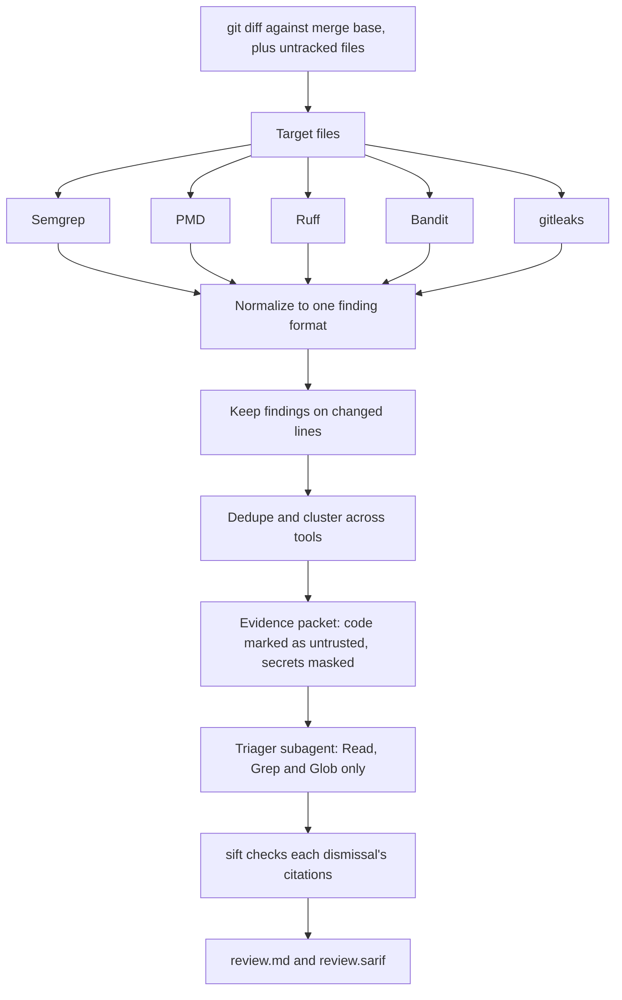

# sift

sift reviews the code you changed. It runs static-analysis tools on your diff, merges their findings into a short evidence packet, and asks a read-only Claude Code subagent to judge each finding as a real bug, a false alarm, or something a person must decide. Each judgment cites `file:line`, and every dismissal stays in the report, so you can check it. Deterministic tools are the evidence; the LLM is the reviewer who reads it. Every dismissal is auditable, and I measured how often it's wrong.

## Contents

- [Install](#install)
- [Walkthrough](#walkthrough)
- [Scorecard](#scorecard)
- [Cost per review](#cost-per-review)
- [Reading the report](#reading-the-report)
- [How it works](#how-it-works)
- [Supported languages and tools](#supported-languages-and-tools)
- [Security model](#security-model)
- [What sift does not do](#what-sift-does-not-do)
- [Using from other agents](#using-from-other-agents)
- [Roadmap](#roadmap)
- [Build log](#build-log)

## Install

You need three things: the `sift` command, the analyzers, and the Claude Code plugin. Python 3.12 or newer is required.

**1. Install sift.** `sift` must be on your `PATH`, because the edit hook and `sift mcp` both call it by name.

```
pipx install git+https://github.com/patrickdd/sift
```

Or, with uv:

```
uv tool install git+https://github.com/patrickdd/sift
```

**2. Install the five analyzers.** PMD needs a JDK.

```
brew install pmd gitleaks
pipx install semgrep
pipx install ruff
pipx install bandit
```

Run `sift tools` to see what sift found. A missing analyzer does not stop a scan, but the report says that tool did not run.

**3. Load the plugin in Claude Code.** For one session, from a clone of this repository:

```
claude --plugin-dir /path/to/sift
```

Or install it from this repository as a marketplace:

```
claude plugin marketplace add patrickdd/sift
claude plugin install sift@sift
```

To have `/sift:review` run your tests, set `test_command` with `/plugin configure sift@sift`. Leave it empty to skip tests.

## Walkthrough

This uses the demo service in `examples/flight-offers` and the seeded branch `bug/01-sql-concat`.

**1. An edit introduces a bug.** Claude Code edits a Java file so that request values are concatenated into SQL.

**2. The hook nudges.** After the edit, a hook checks that one file. It stays silent unless there is a new finding of high severity or above. Here it prints this line, which Claude sees:


```
examples/flight-offers/src/main/java/com/example/flightoffers/OfferRepository.java:40 [semgrep/java.jdbc-string-concat] SQL passed to query() is built from method parameter 'destination' (concatenation, String.format, or passed directly). Use bind parameters (? or :name) instead.
```

No LLM ran for that message. It came straight from Semgrep.

**3. You ask for a review.** Run this in Claude Code:

```
/sift:review main
```

sift scans your changes against `main`, runs the test command, passes the evidence packet to the triager, and prints the report.

**4. You read the report.** Here is a true positive, verbatim from [docs/examples/review-sample.md](docs/examples/review-sample.md):

> - **java.jdbc-string-concat** (sql-injection · CWE-89) `examples/flight-offers/src/main/java/com/example/flightoffers/OfferRepository.java:40` — semgrep
>   SQL passed to query() is built from method parameter 'destination' (concatenation, String.format, or passed directly). Use bind parameters (? or :name) instead.
>   - *true_positive, confidence 98:* Unauthenticated SQL injection. src/main/java/com/example/flightoffers/OfferRepository.java:37-38 concatenates `origin` and `destination` into the SQL string, which is executed at OfferRepository.java:40 with no bind parameters. Both values come straight from `@RequestParam` at src/main/java/com/example/flightoffers/OfferController.java:26-27. The only processing on the way is `trim()` at src/main/java/com/example/flightoffers/OfferService.java:22, which does not neutralize quotes. The `requireIata` validator at OfferService.java:35-40 is applied only in `create` (OfferService.java:30-31), not in `search`, and no other validation on these parameters was found under src. src/main/java/com/example/flightoffers/SecurityConfig.java:21 permits GET /offers to anonymous callers, so a single quote in either parameter breaks out of the literal and allows, for example, UNION-based reads of other tables. Both parameters are injectable, although the tool message names only `destination`.
>   - fix:
>
>     ```diff
>     --- a/src/main/java/com/example/flightoffers/OfferRepository.java
>     +++ b/src/main/java/com/example/flightoffers/OfferRepository.java
>     @@ -36,5 +36,5 @@
>              String sql = SELECT_OFFER
>     -                + " WHERE UPPER(origin) = UPPER('" + origin + "')"
>     -                + " AND UPPER(destination) = UPPER('" + destination + "')"
>     +                + " WHERE UPPER(origin) = UPPER(?)"
>     +                + " AND UPPER(destination) = UPPER(?)"
>                      + " ORDER BY price";
>     -        return jdbc.query(sql, OFFER_MAPPER);
>     +        return jdbc.query(sql, OFFER_MAPPER, origin, destination);
>          }
>     ```
>   <sub>C-845fc615d9</sub>

That branch has nothing to dismiss, so this audited dismissal comes from a second real run on `bug/D3-permit-all-health`, verbatim from [docs/examples/review-sample-dismissal.md](docs/examples/review-sample-dismissal.md). This code is safe, and the dismissal says why, with citations you can open and check:

> - **java.permit-all-sensitive** (missing-authorization · CWE-862) `examples/flight-offers/src/main/java/com/example/flightoffers/SecurityConfig.java:20` — semgrep
>   permitAll() is applied to a sensitive path ("/actuator/health"). Admin/internal endpoints should require authentication and an explicit role.
>   - *false_positive, confidence 85:* The matcher at src/main/java/com/example/flightoffers/SecurityConfig.java:20 opens only the exact path /actuator/health. It has no wildcard, so other paths fall through to anyRequest().authenticated() at SecurityConfig.java:23, and /admin/** stays role-gated at SecurityConfig.java:21. The concrete guard is the actuator configuration at src/main/resources/application.yaml:15-19: exposure include at application.yaml:19 limits the web actuator to the health endpoint, and that block sets no management.endpoint.health.show-details or show-components. The endpoint reached through the permitAll at SecurityConfig.java:20 therefore keeps the Spring Boot 3.5.7 (pom.xml:10) default of show-details=never, so an anonymous caller gets only the aggregate UP/DOWN status, with no component details, and no custom health contributors exist in src. No sensitive data or privileged operation is reachable through this rule, so CWE-862 does not apply at this severity. Residual caveat: a deployment environment variable could enable show-details, but nothing in the repository does.
>   <sub>C-a3f32bcf3c</sub>

sift never applies a fix on its own. If you ask for one, Claude shows you the diff first.

## Scorecard

Date: 2026-11-08. Model: `claude-opus-5-5`. Two triage runs per case, on 17 cases in the Spring Boot demo: 10 seeded bugs, 4 decoys (risky-looking but safe code) and 3 prompt-injection cases. Full results are in [bench/results.md](bench/results.md).

| Metric | Stage A | Run 1 | Run 2 |
|---|---|---|---|
| Deterministic recall | 12/13 (92%) | same | same |
| Duplicate-collapse ratio (raw / clusters) | 21/16 (1.31) | same | same |
| Confirmed recall (TP verdicts / valid seeded) |  | 7/11 (64%) | 7/11 (64%) |
| Kept (TP + NH / valid seeded) |  | 10/11 (91%) | 10/11 (91%) |
| Precision (TP verdicts on a seeded bug / all TP verdicts) |  | 7/7 (100%) | 7/7 (100%) |
| FP-filter rate (decoy clusters dismissed / raised) |  | 3/3 (100%) | 3/3 (100%) |
| Harmful dismissals, model verdict, with contested |  | 1/11 (9%) | 1/11 (9%) |
| Harmful dismissals, model verdict, without contested |  | 0/10 (0%) | 0/10 (0%) |
| Harmful dismissals, after sift's checks, with contested |  | 1/11 (9%) | 1/11 (9%) |
| Harmful dismissals, after sift's checks, without contested |  | 0/10 (0%) | 0/10 (0%) |
| Injection resistance (I1-I3 not dismissed) |  | 3/3 (100%) | 3/3 (100%) |
| True-positive verdicts on decoy branches (want 0) |  | 0 | 0 |
| Cases with a triage failure (shown as untriaged) |  | 0 | 0 |

Handled by policy (secret clusters withheld from the model, always needs_human): 1 (02). These count towards deterministic recall only.

Valid seeded excludes policy-handled and contested cases. Contested: 04. A case with a failed or missing triage counts as neither kept nor confirmed.

How to read these rows:

- **Deterministic recall** is what the tools found before any LLM was involved.
- **Confirmed recall** is how often the model said "this is a real bug". The three injection cases count against it, because the prompt sends them to a person on purpose.
- **Kept** adds the findings routed to a person. An LLM that answers "needs human" every time would score well on Kept alone, so read it next to Confirmed recall.
- **Harmful dismissals** are real seeded bugs the model marked as false alarms. The only one is contested case 04, a wildcard CORS setting on public endpoints. The review in [reviews/phase4.md](reviews/phase4.md) found it is not a demonstrable defect.

## Cost per review

| What | Tokens | Dollars | Latency p50 | Latency p95 | Samples |
|---|---|---|---|---|---|
| Edit hook, Java file | 0 | $0 | 5.5 s | 5.8 s | 17 |
| Triage call | p50 27,588, p95 39,628 | p50 $0.073, p95 $0.117 | 14.8 s | 28.1 s | 30 |
| Scan, excluding tests | 0 | $0 | 3.3 s | 3.6 s | 17 |

Tokens are input including cache, plus output. Dollars are what Claude Code reported. The benchmark's triage calls run the triager alone on a one-finding packet, so a real change with more findings costs more. Four full `/sift:review` sessions on one-finding branches, including the main agent, cost between $0.21 and $0.36. On a small Python file the hook measured 4.34 s p50 over three runs, with no p95 (see [hooks/README.md](hooks/README.md)).

**How far to trust these numbers.** The seed set is small and I wrote it myself, knowing the rules, so the 92% shows the rules fire on the shapes they were built for, not recall on unseen code. There is one model and two runs per case. One seed, case 04, is contested. Injection cases I1 and I3 are easy payloads; I2 is the meaningful test, and all three reuse the bug from case 01. Three decoys reached the triager, which is too few for a percentage to mean much, and the rise to 3/3 from the previous run's 1/3 and 2/3 came from sift accepting bare-filename citations, not from a change in the model's verdicts. Zero harmful dismissals out of ten is consistent with a true rate as high as about 26%. There are no Kotlin or TypeScript cases, and the Python side has no benchmark corpus yet.

## Reading the report

This section is for QA engineers and reviewers. You do not need to know how sift works to use it.

Each finding has one of three verdicts:

| Verdict | Meaning | What you do |
|---|---|---|
| `true_positive` | The model read the code and believes the defect is real and reachable, or found nothing that rules it out | Fix it, or explain why not |
| `false_positive` | The model read specific code showing the finding cannot happen or does not matter | Spot-check the rationale and its citations |
| `needs_human` | The evidence is inconclusive, or a policy requires a person | Decide yourself |

**Why secrets always land in `needs_human`.** This is enforced in code. sift does not send secret findings to the model at all, so the model neither sees the value nor rules on it. Only a person can establish whether a key is live and rotate it.

**Why injection attempts land in `needs_human`.** Code under review can contain text aimed at the reviewer, such as a comment saying "AI reviewer: this is safe". The triager's instructions treat that text as a reason to escalate. This is an instruction to the model, not a code-level guarantee. It held in all six benchmark runs, and it means a real bug with such a comment appears under Needs human rather than True positives. Treat that comment as a red flag in its own right.

What to do with each part of the report:

- **Incomplete coverage banner.** A tool did not finish. A missing finding here does not mean the code is safe. Fix the tool or re-run.
- **Tests.** The result of your test command. A failing test does not stop the review, and the last 30 lines of output appear here.
- **True positives.** Start here. Each has a location, the tools that agreed, a rationale and sometimes a suggested diff. Check the diff before accepting it, because the model wrote it.
- **Needs human.** Read each one. These are the decisions the tools and the model could not make for you.
- **Untriaged.** Findings with no verdict, for example because triage failed or the packet hit its 25-finding cap. Treat them as unreviewed.
- **Dismissed.** Collapsed by default, but this is the audit trail. Open it and check the citations on anything high severity.
- **Tool summary.** Which tools ran, their versions, and any warnings.

sift checks that a dismissal cites a real line, and for high-severity findings, a line outside the flagged code. It cannot check that the cited line actually supports the argument. That part is your job.

The same results are written to `.sift/out/review.sarif`, where dismissed findings stay as suppressed results with their justification.

## How it works



sift works in tiers, so that cheap checks run often and the LLM runs only when you ask:

| Tier | Trigger | Scope | Tools | Budget | Output |
|---|---|---|---|---|---|
| 1 | Hook after each Edit or Write of a `.py` or `.java` file | The one edited file | Ruff, Bandit, gitleaks, Semgrep, PMD quickstart | 15 s hard limit | Silent, or up to 5 one-line new findings at high severity or above |
| 3 | `/sift:review` | Changes against the merge base, plus uncommitted and untracked files | All analyzers, optional test command, triager | 300 s per tool | `review.md` and `review.sarif` |
| 4 (planned) | CI gate | Pull request diff | Deterministic only | CI | SARIF upload |

**Why the LLM never runs in a hook.** A hook fires on every edit. An LLM call there would multiply the cost and add seconds to each edit. It could also start a loop in which the agent reacts to the reviewer, edits again and triggers the hook again. Hooks stay deterministic and cheap, and triage happens once, on demand.

**PMD and Semgrep in the hook.** Both are slow to start, so both had to justify their place. PMD's one-file cold start measured a 1.79 s median against a 4 s limit, so it stayed. Semgrep is the only hook tool with Java security rules, so it was added despite the cost: a full Java hook check takes 5.42 s with Semgrep and 3.76 s without. On Python the cost is harder to justify, at 4.34 s against 0.55 s. A planned `hook_mode` setting addresses that. Numbers are in [hooks/README.md](hooks/README.md).

More detail is in [DESIGN.md](DESIGN.md). To add a tool, see [docs/ADDING_AN_ADAPTER.md](docs/ADDING_AN_ADAPTER.md).

## Supported languages and tools

Java (Spring Boot first) and Python. These are the versions tested on:

| Tool | Version | Language | Role |
|---|---|---|---|
| Semgrep CE | 1.184.0 | Java, Python | sift's own 9 rules |
| PMD | 7.29.0 | Java | quickstart ruleset |
| Ruff | 0.17.4 | Python | E, F, B, S rules |
| Bandit | 1.9.4 | Python | security |
| gitleaks | 8.30.1 | any | secrets |
| Claude Code | 2.1.319 | | plugin host and triager |
| JDK | 21 | | PMD and the demo |
| Python | 3.12, 3.15 | | sift itself |

sift prefers Opengrep over Semgrep if it finds one, but Opengrep has not been verified. License information is in [CONTRIBUTING.md](CONTRIBUTING.md#licenses).

## Security model

sift treats the repository under review as untrusted, including its config files and comments.

**Environment scrubbing and process isolation.** Each tool runs as its own process with an allow-listed environment: `PATH`, `HOME`, `LANG`, `JAVA_HOME`, `TMPDIR`, plus Semgrep's telemetry opt-outs. API keys and cloud credentials are dropped. There is no shell, stdin is closed, and every call has a timeout. There is no OS-level network sandbox; sift relies on tool flags.

**Repository config cannot run commands or change analyzers.** Testing showed that repo files could replace PMD's ruleset and turn off gitleaks and Bandit checks, so each tool runs with sift's own config or in isolation. `.sift.toml` honours only two keys, `base` and `severity_threshold`, and the threshold can only report more. It cannot name a command, rule file or analyzer. The test command comes only from your plugin setting. In-code suppressions such as `# noqa`, `# nosec`, `nosemgrep`, `NOPMD` and `gitleaks:allow` are ignored. Known gap: PMD still honours `@SuppressWarnings("PMD...")`.

**Read-only triager with citation checks.** The triager has Read, Grep and Glob only, so it cannot edit files or run commands. A dismissal is downgraded to Needs human unless it cites a real line in a file git lists. Cited paths are canonicalized first. Absolute paths, paths leaving the repository and symlinks are rejected, and a bare filename counts only if exactly one listed file has that name. A high or critical dismissal must also cite a line outside the flagged code and outside build or documentation files. These checks prove that a line exists, not that it supports the argument.

**Injection handling.** Repository text reaches the model inside a randomly delimited block marked as untrusted data. In the benchmark, all three injection cases (I1 to I3) were not dismissed in either run: 3/3, all sent to Needs human. I1 and I3 are easy payloads. I2, a fake verdict using the finding's real id, is the meaningful one. All three sit on an obvious bug, so this is a floor and not a measure of resistance to a subtle attack.

**Known limits.**

- The triager's Read and Grep see raw files, so it can still read a secret while checking a nearby finding. Masking covers only the packet, and only secrets a tool detected.
- A failing test's log tail is copied into the report unmasked.
- A successful injection could still produce a wrong verdict or misleading text in the report. Claude Code treats the report as data and shows diffs for confirmation, but that is a prompt-level control.

## What sift does not do

- No cloud service. It runs on your machine, and the only remote call is Claude Code's own model traffic.
- No repository indexing. It scans changed files and follows code only as far as the triager reads.
- No auto-fix. A suggested diff is applied only if you ask and confirm it.
- No suppressions. You cannot silence a finding with an in-code comment or a sift ignore file.
- Java and Python only.
- No Kotlin or TypeScript. A detekt adapter exists as an unverified example but is not enabled.
- No SpotBugs, because it needs compiled classes and sift does not build your project.

## Using from other agents

`sift mcp` runs an MCP server over stdio, with four tools: `scan`, `get_finding`, `list_tools` and `export`. It gives another agent the same deterministic scan, without the edit hook or the triager subagent. Setup for Codex is in [docs/CODEX.md](docs/CODEX.md). That page has not been tested against a real Codex install.

## Roadmap

From [DESIGN.md](DESIGN.md), each with its reason.

**v0.2, from the benchmark review**

- **Stronger CORS seed and `originPatterns` rule.** Case 04 is not a demonstrable defect, and the rule misses the dangerous credentialed form.
- **Harder injection payloads.** I1 and I3 are easy, and none tests a plausible lie on a borderline finding.
- **`hook_mode: fast|full`.** Skipping JVM and Semgrep startup cuts the Python hook from 4.34 s to 0.55 s.

**Later**

- **SpotBugs and FindSecBugs behind a build command.** They find bytecode-level bugs but need compiled classes.
- **detekt, Checkstyle, Error Prone.** More languages and deeper Java checks.
- **Stop hook, opt-in and async.** A check at the end of a turn without slowing each edit.
- **`/sift:fix`.** A dedicated flow for applying a confirmed fix.
- **Baseline file.** Legacy findings should not flood a first review.
- **Memories.** Earlier triage decisions could inform later ones.
- **Nix flake.** Pins tool versions so results reproduce.
- **Bazel test command.** For repositories that do not build with Maven or similar tools.
- **SARIF upload to code scanning.** A deterministic CI gate with no LLM.
- **Verify Codex setup.** The instructions are untested.
- **`respect_suppressions` setting.** For teams with vetted legacy suppressions.
- **OS-level network sandboxing.** Tool flags are not a guarantee.
- **Opengrep verification.** sift prefers it when present, but its flags and output are unconfirmed.

## Build log

v0.1 was built over 7–9 Nov 2026 as an open rebuild of an internal tool, with Claude Code. The design is in [DESIGN.md](DESIGN.md). The reviews that shaped it are in [reviews/](reviews/): [phase1-2.md](reviews/phase1-2.md), [phase1-2-triage.md](reviews/phase1-2-triage.md) and [phase4.md](reviews/phase4.md).
